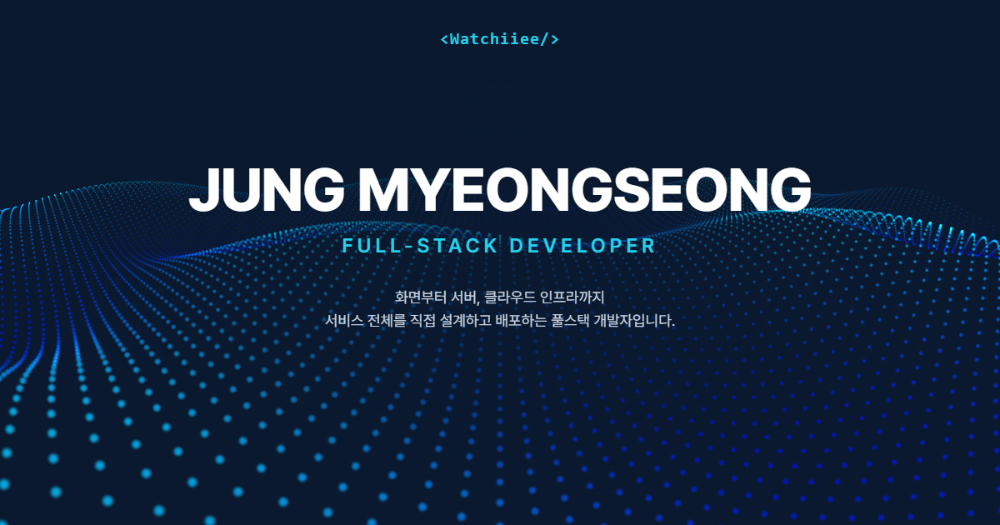

# 정명성 포트폴리오

풀스택 개발자 정명성의 포트폴리오 웹사이트입니다.

**🔗 https://watchiiee.github.io**



## 소개

화면부터 서버, 클라우드 인프라까지 직접 설계하고 배포한 프로젝트들을 정리한 사이트입니다.

- **Hero**: Three.js 셰이더로 그린 파티클 물결 배경
- **Expertise**: Frontend · Backend · Cloud & DevOps · AI/LLM 기술 스택
- **Projects**: 프로젝트별 상세 설명, 스크린샷 갤러리, 트러블슈팅 기록
- **Resume / Contact**: 이력과 연락처

## 기술 스택

| 분류 | 사용 기술 |
| :-- | :-- |
| Framework | Astro, React |
| Language | TypeScript |
| Styling | Tailwind CSS, shadcn/ui |
| Animation · 3D | Framer Motion, Three.js |
| Deploy | GitHub Actions, GitHub Pages |

## 구현 포인트

- **필요한 곳만 JavaScript**: 대부분은 Astro로 정적 HTML을 만들고, 움직임이 필요한 컴포넌트만 React로 불러옵니다(Astro Islands).
- **가벼운 3D 배경**: 파티클 물결은 화면에서 벗어나면 렌더링을 멈추고, 모바일에서는 파티클 수를 줄입니다.
- **데이터 기반 프로젝트 목록**: `Projects.tsx`의 데이터에 항목만 추가하면 카드, 상세 화면, 갤러리가 함께 생성됩니다.
- **이미지 최적화**: 스크린샷은 WebP로 변환해 장당 100KB 안팎으로 맞췄고, 화면 속 개인정보는 모자이크했습니다.
- **자동 배포**: `main` 브랜치에 푸시하면 GitHub Actions가 빌드 후 GitHub Pages에 배포합니다.

## 프로젝트 구조

```text
/
├── .github/workflows/deploy.yml   # GitHub Pages 자동 배포
├── public/                        # 프로젝트 스크린샷, OG 이미지, 파비콘
└── src/
    ├── components/
    │   ├── sections/              # Hero, Expertise, Projects, Resume, Contact
    │   ├── ui/                    # 공통 UI 컴포넌트 (button, card, badge 등)
    │   └── ParticleWave.tsx       # Three.js 파티클 배경
    ├── layouts/Layout.astro       # 공통 레이아웃, 메타 태그
    ├── pages/index.astro          # 메인 페이지
    └── styles/global.css
```

## 로컬에서 실행하기

```sh
npm install      # 의존성 설치
npm run dev      # 개발 서버 실행 (http://localhost:4321)
npm run build    # 프로덕션 빌드 (./dist)
npm run preview  # 빌드 결과 미리보기
```

## Contact

- Email: op7970@gmail.com
- GitHub: [@Watchiiee](https://github.com/Watchiiee)
